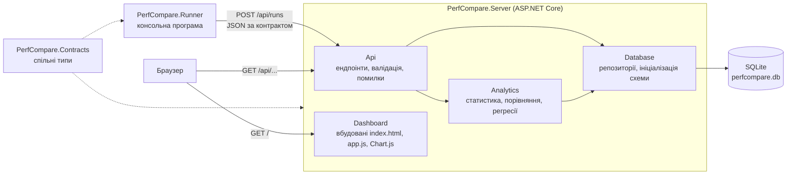
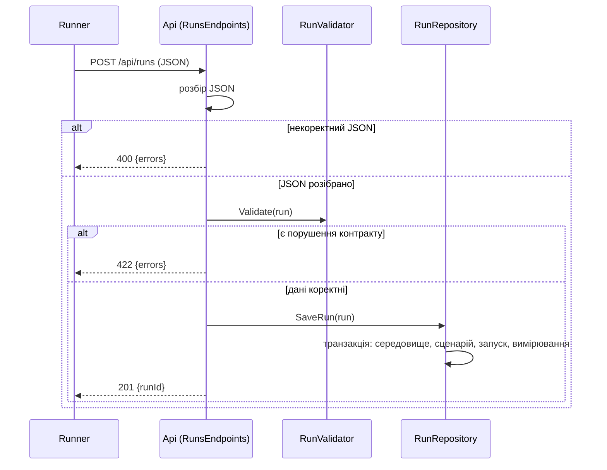
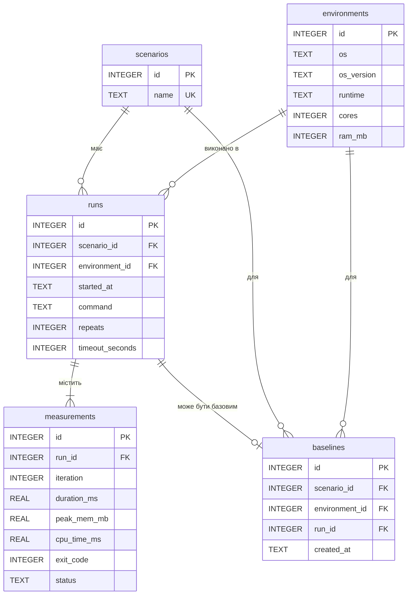

# Архітектура PerfCompare

PerfCompare порівнює продуктивність одного й того самого сценарію в різних середовищах (ОС, версія, кількість ядер, обсяг пам'яті). Система складається з двох програм і спільного проєкту контракту.

## Компоненти

| Проєкт | Відповідальність |
|---|---|
| `PerfCompare.Contracts` | типи обміну між runner і server (`RunResult`, `Measurement`, `EnvironmentInfo`), налаштування JSON |
| `PerfCompare.Runner` | запускає сценарій задану кількість разів, міряє час, пам'ять і процесорний час, відправляє результат на сервер або зберігає у файл для відправлення пізніше |
| `PerfCompare.Server` | приймає результати, зберігає їх, рахує статистику, порівняння й регресії, віддає дашборд, CSV і HTML-звіт |

## Шари сервера

| Шар | Каталог | Що робить | Від чого залежить |
|---|---|---|---|
| Api | `src/PerfCompare.Server/Api` | маршрути, розбір параметрів, `RunValidator`, формат помилок, глобальний обробник винятків | Analytics, Database |
| Analytics | `src/PerfCompare.Server/Analytics` | `RunStatsCalculator`, `ComparisonService`, `RegressionDetector`, `RegressionService`; не знає про HTTP | Database |
| Database | `src/PerfCompare.Server/Database` | `SqliteConnectionFactory`, репозиторії, `DatabaseInitializer`, `schema.sql` | SQLite |
| Dashboard | `src/PerfCompare.Server/Dashboard` | статичні файли, вбудовані в збірку | лише ендпоінти Api |

Правило залежностей: Api викликає Analytics і Database, Analytics викликає Database, зворотних залежностей немає. Завдяки цьому статистику й виявлення регресій тестують без HTTP, а ендпоінти тестують через `WebApplicationFactory` з окремою тимчасовою базою.

## Потік: збереження результату

## Потік: порівняння і регресія

`GET /api/compare` бере для сценарію останній запуск у кожному середовищі, рахує статистику (`RunStatsCalculator`: мінімум, максимум, середнє, медіана, P95, стандартне відхилення, коефіцієнт варіації, індекс стабільності) і показує, у скільки разів кожне середовище повільніше за найшвидше. `GET /api/regressions` порівнює запуск із базовим запуском (`baselines`) цього ж сценарію й середовища за заданим порогом у відсотках і повертає статус `ok`, `regression` або `no_baseline`.

## Обробка помилок

| Ситуація | Відповідь |
|---|---|
| тіло не є коректним JSON | `400` і `{"errors": [...]}` |
| дані порушують контракт, некоректні параметри запиту | `422` з переліком усіх знайдених проблем |
| ресурс не знайдено | `404` |
| несподіваний виняток (наприклад, база недоступна) | `500` і `{"errors": ["внутрішня помилка сервера"]}`, подробиці лише в журналі |

Крайні випадки та тести для них описані в [edge-cases-server.md](edge-cases-server.md).

## База даних

### Цілісність даних

| Вимога | Як виконано |
|---|---|
| Первинні ключі | у кожної таблиці `id INTEGER PRIMARY KEY AUTOINCREMENT` |
| Зовнішні ключі | `runs` посилається на `scenarios` і `environments`; `measurements` і `baselines` на `runs`; `baselines` також на `scenarios` і `environments`; для `measurements.run_id` і `baselines.run_id` задано `ON DELETE CASCADE`; фабрика з'єднань виконує `PRAGMA foreign_keys = ON` для кожного з'єднання |
| Унікальність | `scenarios.name`; набір `(os, os_version, runtime, cores, ram_mb)` у `environments`; `(run_id, iteration)` у `measurements`; `(scenario_id, environment_id)` у `baselines` - одна базова лінія на пару сценарій-середовище |
| Обмеження значень | `CHECK` для `cores`, `ram_mb`, `repeats`, `timeout_seconds`, `iteration`, невід'ємних часу й пам'яті та переліку `status`; перевірка в базі повторює перевірку `RunValidator` на випадок запису в обхід API |
| Індекси | `idx_runs_scenario`, `idx_runs_environment`, `idx_measurements_run` для вибірок за сценарієм, середовищем і запуском; решта пошуків іде через унікальні індекси, які створюють `UNIQUE`-обмеження |
| Параметризовані запити | усі значення передаються через `SqliteParameter`, конкатенації SQL зі значеннями користувача в коді немає |
| Транзакції | `SaveRun` (середовище, сценарій, запуск і всі вимірювання) і `SetBaseline` виконуються в одній транзакції: або записано все, або нічого |
| Ініціалізація | `DatabaseInitializer` виконує `schema.sql` при старті; усі оператори `IF NOT EXISTS`, тому повторний запуск безпечний |

### Нормалізація

- 1НФ: усі стовпці атомарні, повторюваних груп немає. Вимірювання запуску винесені в окрему таблицю `measurements`, а не в стовпці `duration_1`, `duration_2`.
- 2НФ: кожна таблиця має простий ключ `id`, часткових залежностей немає.
- 3НФ: опис середовища живе лише в `environments`, назва сценарію лише в `scenarios`; `runs` зберігає тільки посилання на них і власні поля запуску, тому транзитивних залежностей немає.
- Свідоме відхилення: у `baselines` стовпці `scenario_id` і `environment_id` можна вивести з `run_id` через `runs`. Вони збережені, щоб `UNIQUE (scenario_id, environment_id)` гарантувала на рівні бази одну базову лінію на пару. Узгодженість забезпечує `SetBaseline`: він бере обидва значення з самого запуску в тій самій транзакції. Це описано в `docs/decisions.md`.
